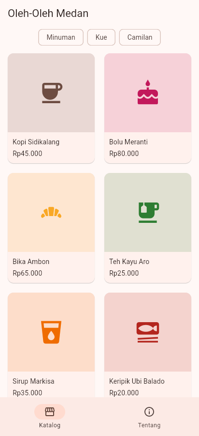
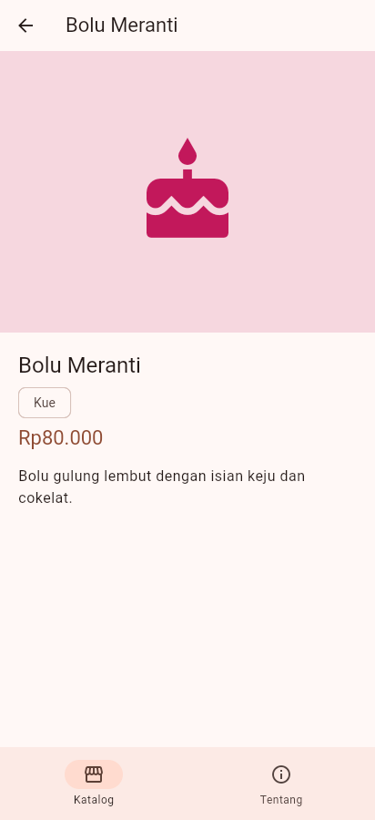
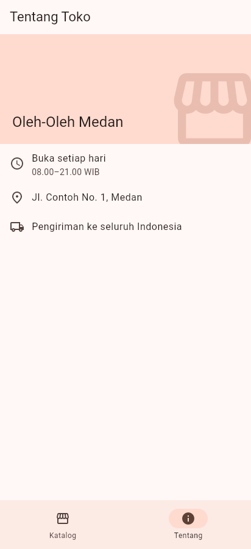
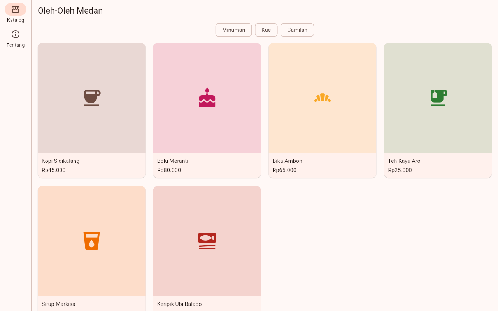
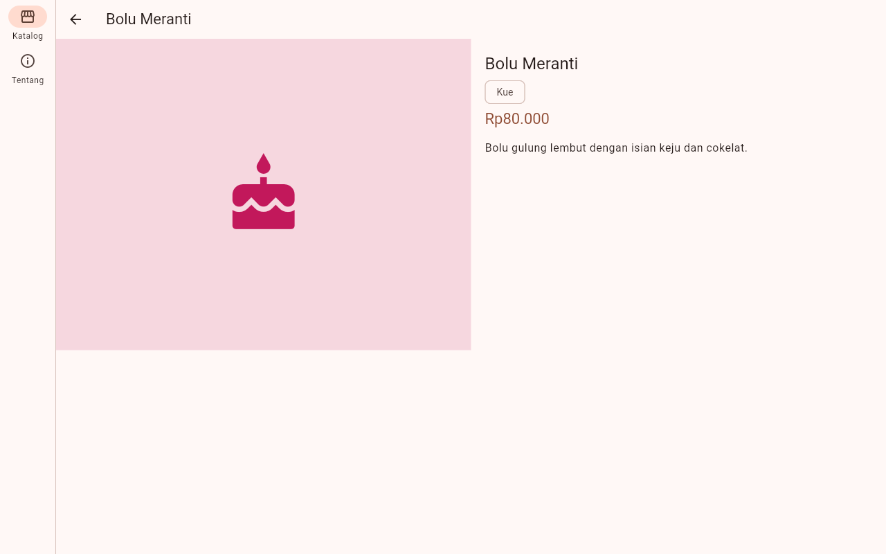

# Praktikum Pertemuan 6 — Katalog Produk Multi-Screen

Pemrograman Mobile (3KOM40215) · Pertemuan 6 · Ilmu Komputer UNIMED

| | |
|---|---|
| Nama  | Muhammad Tsabat Muhyiyuddin |
| NIM   | 4243250002 |
| Kelas | PSIK24D |
| GitHub | [tsabat15](https://github.com/tsabat15) |

## Cara menjalankan

```
flutter pub get
flutter run -d chrome
flutter test
```

## Tampilan

Tangkapan layar diambil dari versi web di Chrome dengan ukuran jendela yang diatur.

| Lebar 412 px: katalog | Lebar 412 px: detail | Lebar 412 px: tentang |
|---|---|---|
|  |  |  |

**Lebar 1280 px: NavigationRail dan grid 4 kolom**



**Lebar 1280 px: detail berdampingan**



## Tantangan yang dikerjakan

- **Tantangan 1:** `FilterChip` kategori di atas grid; `HalamanKatalog` menjadi Stateful.
- **Tantangan 3:** ikon produk dibungkus `Hero(tag: produk.id, ...)` di kartu dan detail.

Tantangan 2 (rute `/kategori/:nama`) belum dikerjakan.

## Dokumen

Lembar Kerja Praktikum (C) dan Latihan Mandiri (E) ada di `dokumen/`. Proyek ini dilanjutkan pada Pertemuan 7 dengan fitur keranjang.

## Pernyataan penggunaan AI

Saya menggunakan asisten AI untuk membantu menyalin dan menguji kode modul, mengerjakan tantangan, dan menyusun README ini. Saya bertanggung jawab memahami seluruh isinya.
